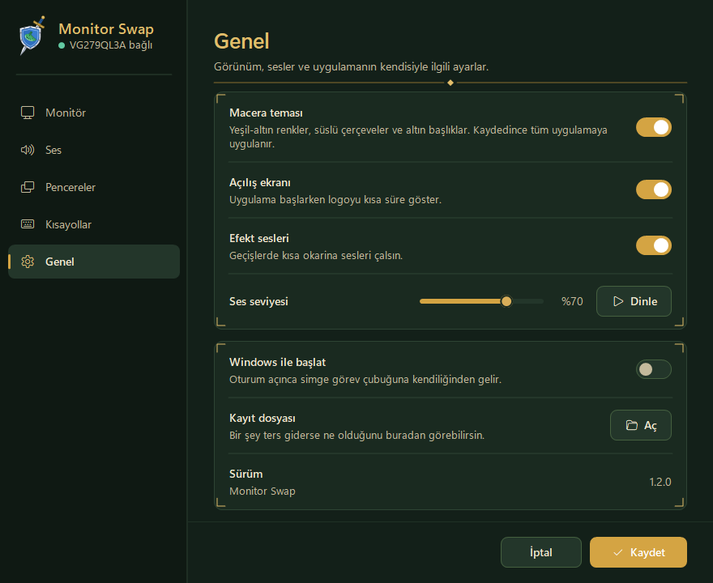
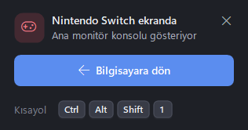

# Monitor Swap

Laptopum monitöre DisplayPort ile bağlı, Switch de aynı monitörün HDMI girişinde. Her seferinde monitörün altındaki küçük düğmelere uzanıp menüde giriş aramaktan sıkıldım, bunu yazdım.

Bir kısayola basıyorsun, monitör konsola geçiyor. Bir daha basıyorsun, bilgisayara dönüyor. Monitörle zaten takılı olan görüntü kablosu üzerinden (DDC/CI) konuşuyor, ekstra bir şey gerekmiyor.

<p align="center">
  
</p>

## Ne yapıyor

- `Ctrl+Alt+Shift+2` konsola, `Ctrl+Alt+Shift+1` bilgisayara geçiriyor. İstersen değiştirebilirsin.
- Konsola geçince ana monitördeki pencereleri laptop ekranına alıyor, dönünce eski yerlerine koyuyor. Böylece Discord falan gözünün önünde kalıyor.
- Laptop ekranının köşesinde küçük bir "Bilgisayara dön" paneli çıkıyor.
- Konsolu kapatınca monitör kendiliğinden bilgisayara dönerse bunu fark ediyor, pencereleri geri yerleştiriyor.
- Geçişlerde kısa okarina sesleri çalıyor. Sesleri kendim ürettim; ayarlardan kısabilir ya da kapatabilirsin.
- İstersen konsol modunda bilgisayarın sesini başka bir cihaza (kulaklık gibi) aktarıyor.
- `Ctrl+Alt+Shift+M` efekt seslerini açıp kapatıyor; tepsi menüsünden de yapılabiliyor.
- Varsayılan görünüm sade ve koyu. İstersen ayarlardan yeşil-altın, süslü bir "Macera" temasını açabilirsin.

<p align="center">
  
</p>

İnternete bağlanmıyor, hiçbir yere veri göndermiyor. Kurulum da yok, tek bir exe.

<p align="center">
  
</p>

## Kurulum

1. [Releases](https://github.com/amigohan/MonitorSwap/releases/latest) sayfasından `MonitorSwap.exe`'yi indir.
2. Silmeyeceğin bir klasöre koy ve çalıştır.
3. Windows "bilgisayarınızı korudu" derse **Ek bilgi → Yine de çalıştır**. Exe imzalı değil, o yüzden bu uyarı çıkıyor.
4. İlk açılışta ayarlar geliyor. Bilgisayarın ve konsolun hangi girişte olduğunu seç, **Dene** ile kontrol et, kaydet.

Uygulamanın eski adı EkranGeçiş'ti. Eski sürümü kullanıyorsan yenisini açman yeterli; ayarların kendiliğinden taşınıyor. Eski `EkranGecis.exe`'yi silebilirsin.

Monitörün menüsünde **DDC/CI** açık olmalı. Çoğu monitörde varsayılan olarak açık; değilse genelde "Sistem" ya da "Kurulum" menüsünde bulunuyor.

## Bilmen gerekenler

- Her monitörde çalışmayabilir. Bazı monitörler girişi değiştirince bilgisayarla bağlantıyı kesiyor, o zaman geri dönmek için yine düğmeye basman gerekiyor. Ayarlardaki **Dene** butonu bunu güvenle test ediyor, 5 saniye sonra kendisi geri dönüyor.
- Bazı LG ve Samsung modelleri standart dışı giriş kodları kullanıyor.
- FxSound gibi ses programları kendini sürekli varsayılan cihaz yapıyor, ses yönlendirme o yüzden işe yaramayabilir.
- Bir sorun olursa **Ayarlar → Genel → Kayıt dosyası**'na bak.

## Kendin derlemek istersen

[.NET 8 SDK](https://dotnet.microsoft.com/download/dotnet/8.0) lazım:

```bash
dotnet publish MonitorSwap/MonitorSwap.csproj -c Release -o dist
```

`v1.2.3` gibi bir etiket gönderince GitHub exe'yi kendisi derleyip Releases'a koyuyor.

## Lisans

[MIT](LICENSE)

Bu proje Nintendo, Sony, Microsoft ya da ASUS ile bağlantılı değil. Ürün adları sadece örnek olarak geçiyor.
