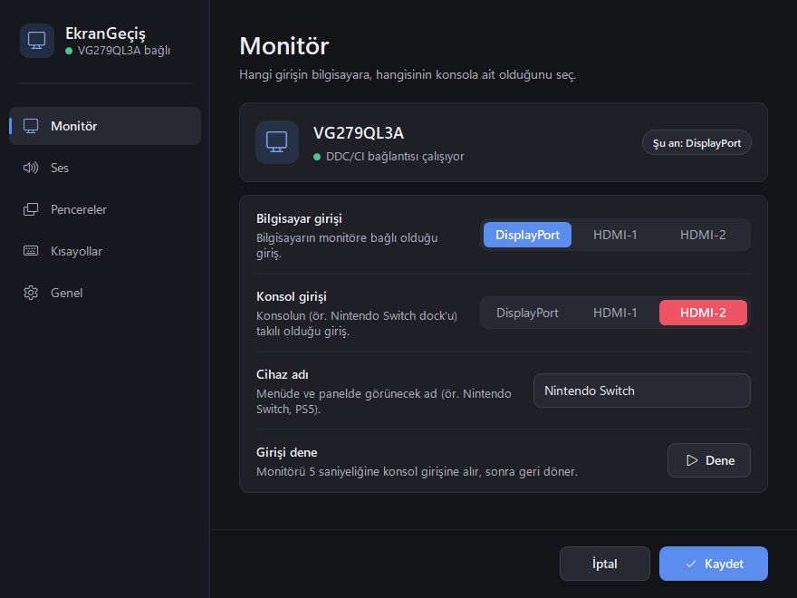

# EkranGeçiş

Monitörünün girişini **tek tuşla** bilgisayar ile konsol (Nintendo Switch, PS5, Xbox…) arasında değiştiren küçük bir Windows uygulaması. Monitörün düğmelerine uzanmana gerek kalmaz.

Uygulama monitörle, zaten bağlı olan görüntü kablosu üzerinden **DDC/CI** ile konuşur. Ek donanım gerekmez.

<p align="center">
  
</p>

## Özellikler

- **Kısayol tuşları:** `Ctrl+Alt+Shift+2` konsola, `Ctrl+Alt+Shift+1` bilgisayara geçirir. Kısayolları istediğin gibi değiştirebilirsin.
- **Görev çubuğu simgesi:** Mavi = bilgisayar, kırmızı = konsol. Tıklayınca menü açılır.
- **Pencereleri taşıma:** Konsola geçince ana monitördeki pencereler ikinci ekrana (ör. laptop ekranı) alınır, dönünce eski yerlerine konur.
- **Kontrol paneli:** Konsol modunda ikinci ekranın köşesinde "Bilgisayara dön" paneli çıkar.
- **Ses yönlendirme:** İstersen konsol modunda bilgisayarın sesi başka bir cihaza (ör. kulaklık) aktarılır, dönünce geri alınır.
- **Otomatik algılama:** Konsolu kapatınca monitör kendiliğinden bilgisayara dönerse uygulama bunu fark eder ve pencereleri/sesi geri alır.
- Kurulum gerektirmez, tek exe dosyası. İnternete bağlanmaz, hiçbir veri göndermez.

<p align="center">
  
</p>

## İndirme ve kurulum

1. [**Releases**](https://github.com/amigohan/EkranGecis/releases/latest) sayfasından `EkranGecis.exe` dosyasını indir.
2. Kalıcı bir klasöre koy (ör. `Belgeler\EkranGecis`) ve çalıştır.
3. Windows **"Windows bilgisayarınızı korudu"** uyarısı gösterirse **Ek bilgi → Yine de çalıştır**'a tıkla.
   Bu uyarı, uygulama ücretli bir kod imzalama sertifikasıyla imzalanmadığı için çıkar.
4. İlk açılışta ayarlar penceresi gelir. Bilgisayarın ve konsolun takılı olduğu girişleri seç, **Dene** ile kontrol et, **Kaydet**'e bas.
5. İstersen **Genel → Windows ile başlat**'ı aç.

## Gereksinimler

- Windows 10 veya 11 (64 bit)
- **DDC/CI destekleyen bir monitör.** Çoğu modern monitör destekler; monitörün kendi menüsünde **DDC/CI** ayarının **açık** olması gerekir (genelde "Sistem", "Kurulum" ya da "Diğer" menüsünde).
- Bilgisayar monitöre kabloyla bağlı olmalı (HDMI, DisplayPort veya USB-C). Bazı USB yerleştirme istasyonları (dock) DDC/CI'yı iletmez.

## Bilinen durumlar

- **Bazı monitörler girişi değiştirince bağlantıyı keser.** Bu durumda bilgisayardan geri dönmek mümkün olmaz; monitörün düğmesini kullanman gerekir. Ayarlardaki **Dene** butonu bunu güvenle test eder (5 saniye sonra kendiliğinden geri döner).
- **Bazı LG ve Samsung modelleri** standart dışı giriş kodları kullanır; bu monitörlerde uygulama çalışmayabilir.
- **Ses düzenleyici programlar** (ör. FxSound) kendilerini sürekli varsayılan ses cihazı yapar ve ses yönlendirmeyi geri alır. Uygulama bunu fark edip uyarı gösterir.
- Bazı antivirüs programları kısayol dinleyen ve pencere taşıyan programlara şüpheyle bakabilir. Kaynak kod bu depoda; istersen kendin derleyebilirsin.
- Sorun olursa **Ayarlar → Genel → Kayıt dosyası** ile ne olduğunu görebilirsin.

## Kaynaktan derleme

[.NET 8 SDK](https://dotnet.microsoft.com/download/dotnet/8.0) gerekir.

```bash
dotnet publish EkranGecis/EkranGecis.csproj -c Release -o dist
```

Çıktı: `dist/EkranGecis.exe` (.NET kurulu olmayan bilgisayarlarda da çalışır).

Yeni sürüm yayınlamak için `v1.2.3` biçiminde bir etiket gönderilir; GitHub Actions exe'yi derleyip Releases'a ekler.

## Lisans

[MIT](LICENSE)

---

Bu proje Nintendo, Sony, Microsoft veya ASUS ile bağlantılı değildir; ürün adları yalnızca örnek olarak geçer.
